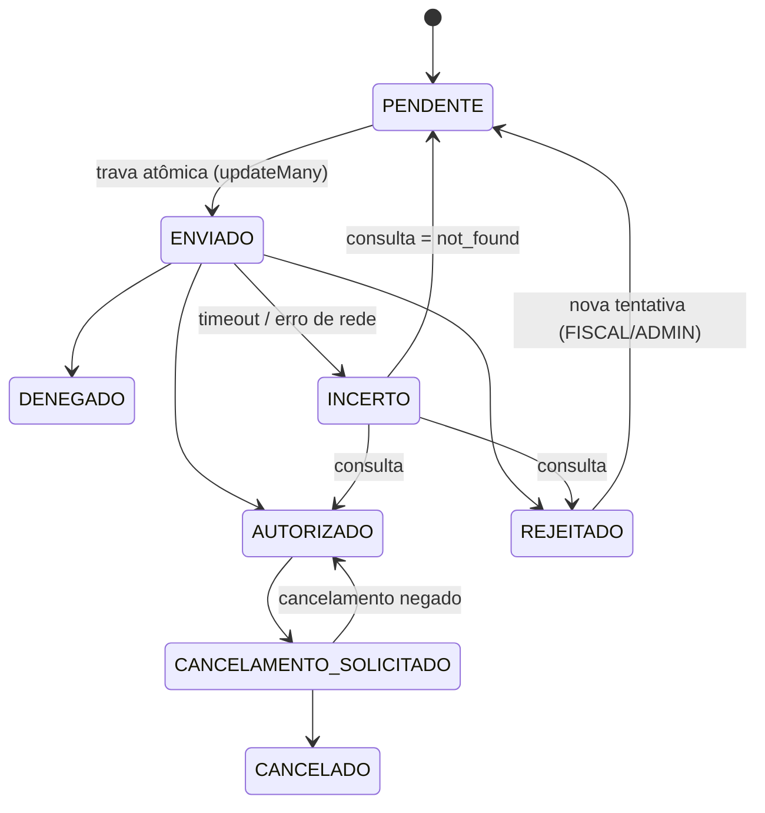

# Arquitetura do NESS: contratos, estados e reconciliação

Para quem mantém o código. Descreve o que **está implementado** (com o arquivo de origem), não intenções.
Quando o código e este documento divergirem, o código vence e este documento deve ser corrigido.

## Módulos

| Módulo | Arquivo | Papel |
|---|---|---|
| Pedido de emissão | `src/app/pedidos/novo/actions.ts` | Valida (Zod, `src/domain/order-input.ts`) e salva pedido + 2 notas, idempotente por `ref` |
| Estados | `src/domain/states.ts` | Fonte única de estados, transições e chave de idempotência |
| Motor de configuração fiscal | `src/fiscal/matrix.ts`, `src/fiscal/resolve-order.ts` | Resolve a regra aprovada e vigente; sem ela, bloqueia |
| Orquestrador | `src/orchestrator/emit.ts` | Envia, reconcilia e reabre notas; deriva o estado do pedido |
| Adaptadores NFS-e / NF-e | `src/emitters/types.ts`, `src/emitters/registry.ts` | Contrato; registro devolve `null` até as Fases 4/5 |
| Auditoria | `src/audit/audit.ts` | Append-only: ator, ação, entidade, resultado, correlation ID |

Não há fila nem worker: o envio roda dentro da server action, uma nota após a outra (NFS-e primeiro).

## Contrato do emissor (`src/emitters/types.ts`)

```ts
send(req)  → authorized{accessKey, protocol} | rejected{code, message} | denied{code, message} | timeout
query(req) → authorized{…} | rejected{…} | not_found | unknown
```

`req` = `{ documentId, docType, idempotencyKey }`. O adaptador deve:
- tratar `idempotencyKey` como identificador da tentativa junto ao governo (consultas usam a mesma chave);
- devolver `timeout` em qualquer falta de resposta; o orquestrador também converte exceções em `timeout`;
- nunca devolver `authorized` sem resposta autêntica do governo.

## Estados da nota



`DENEGADO` e `CANCELADO` são finais. Transição fora da tabela lança erro (`assertTransition`).
Cancelamento está só no modelo de estados; não há ação de cancelar ainda.

## Estado do pedido

Antes da emissão: `PRONTO_REVISAO` (as duas notas têm regra) ou `BLOQUEADO`. Desistência antes de qualquer envio (nenhuma tentativa registrada): `DESCARTADO` (`discardOrder`), final; envio, descarte e correção de destinatário usam a mesma trava por pedido (`src/lib/order-lock.ts`), assim como a reverificação de regras, então nunca se intercalam. Depois, é **derivado** das notas (`deriveOrderState`):

| Notas | Pedido |
|---|---|
| todas AUTORIZADO | COMPLETO |
| alguma PENDENTE / ENVIADO / INCERTO | EMITINDO |
| alguma AUTORIZADO, nenhuma em andamento | PARCIAL |
| nenhuma AUTORIZADO, nenhuma em andamento | FALHA |
| alguma CANCELAMENTO_SOLICITADO | CANCELAMENTO_SOLICITADO |

## Idempotência e tentativas

- **Pedido:** `ref` (UUID gerado no navegador e guardado na aba) é único; salvar duas vezes devolve o mesmo pedido.
- **Nota:** `@@unique([orderId, type])`, uma NFS-e e uma NF-e por pedido.
- **Tentativa:** chave `pedido:tipo:seq` (`idempotencyKey`), única no banco. `seq` = nº de tentativas anteriores + 1.
- **Concorrência:** só um processo passa `PENDENTE → ENVIADO` (`updateMany where state = PENDENTE`); o outro recebe "Envio já em andamento".
- **Retry automático:** não existe. Toda nova tentativa é ação humana (emitir de novo uma nota `PENDENTE`, ou reabrir uma `REJEITADO`).

## Numeração da NF-e (`src/emitters/nfe/numbering.ts`)

Decisão de projeto (prática comum dos emissores; revisar com o responsável fiscal se a operação exigir outra):
- **Quando:** o número é reservado no primeiro envio da NF-e (`reserveNfeNumber`), não ao salvar o pedido. Pedido nunca emitido não consome número.
- **Novas tentativas reusam o número:** nota rejeitada não foi autorizada, então o reenvio usa o mesmo (série, número). Assim não sobra lacuna a inutilizar.
- **Unicidade:** tabela `NfeNumber` com chave primária (estabelecimento, série, número) e `documentId` único; o contador `Establishment.nfeNextNumber` sobe com `UPDATE … RETURNING` dentro da mesma transação. Corrida na mesma nota desfaz a transação perdedora, inclusive o incremento.
- **Configuração:** série e próximo número não têm padrão; o ADMIN informa uma única vez em *Configuração fiscal* (a empresa pode estar continuando a sequência de outro emissor). Sem isso, a reserva é bloqueada com explicação.
- **Ainda não feito:** inutilização de faixa (para número reservado que nunca será usado, ex.: NF-e rejeitada que nunca será reenviada) e ligação ao adaptador real (Fase 4). A chave de acesso usa o número reservado (`src/emitters/nfe/access-key.ts`).

## Timeout e reconciliação

1. Sem resposta → nota `INCERTO`. **Não é rejeição nem autorização.**
2. A interface bloqueia o reenvio e oferece "Consultar notas sem resposta" (`reconcileDocument`).
3. A consulta usa a chave da **última** tentativa:
   - `authorized` / `rejected` → estado definitivo;
   - `not_found` → `PENDENTE` (governo confirmou que não recebeu; o próximo envio usa `seq+1`);
   - `unknown` ou erro → continua `INCERTO`.

**Envio interrompido** (processo caiu ou deploy no meio do envio): nota em `ENVIADO` cuja última tentativa não terminou há mais de 5 minutos (`STALE_SENT_MS`) vira `INCERTO` ao pedir a consulta (`markStaleSent`) e segue o fluxo acima. Se nem a tentativa chegou a ser registrada, nada foi enviado: a consulta a devolve a `PENDENTE`.

Timeouts de rede (valores e mTLS) ficam a cargo dos adaptadores reais (Fases 4/5); ainda não definidos.

## Resolução de regra fiscal (`src/fiscal/matrix.ts`)

Candidatas: aprovadas, do estabelecimento, mesmo tipo de nota e finalidade, dentro da vigência (`validFrom ≤ agora < validTo`) e com UF compatível (vazia = qualquer).
Vence a mais específica e, no empate, a maior versão. Empate total → bloqueio por conflito.
Finalidades usadas hoje: NFS-e `servico-fotografico`, NF-e `album` (`src/fiscal/resolve-order.ts`).

A regra é resolvida ao salvar o pedido **e de novo** antes de cada envio (`refreshOrderRules`): regra vencida bloqueia o pedido.

**Pendência fiscal:** o pedido não informa município à resolução, então regra com município preenchido nunca é aplicada.
É preciso o responsável fiscal definir qual município vale (prestação do serviço para NFS-e? destino para NF-e?) e o pedido passar a guardar o código IBGE correspondente. Até lá, o servidor recusa criar regra com município (`src/fiscal/rule-input.ts`) e o campo não aparece no formulário.

## Cliente (tomador)

Um cadastro por CPF/CNPJ, gravado sem pontuação. Ao salvar um pedido, nome e e-mail digitados atualizam o cadastro (`cliente.atualizar`).
Salvamentos simultâneos do mesmo documento são serializados com `pg_advisory_xact_lock` (`src/app/pedidos/novo/actions.ts`).

**Pendente (exige confirmação humana):** índice `UNIQUE` em `Customer.document`. Antes, fundir duplicados antigos:
1. backup do banco;
2. `npm run customers:merge` (só lista) e conferir;
3. `npm run customers:merge -- --apply` (irreversível: mantém o cadastro mais antigo de cada grupo e repassa os pedidos);
4. só então criar a migração do índice.

## Auditoria

Eventos gravados: `auth.login`, `pedido.verificacao_fiscal`, `pedido.criar`, `pedido.emitir` (bloqueado sem emissor), `pedido.reverificar_regras`, `pedido.descartar`, `pedido.corrigir_destinatario`, `nota.enviar`, `nota.reconciliar`, `nota.reabrir`, `nota.envio_interrompido`, `cliente.atualizar`, `regra_fiscal.criar`, `regra_fiscal.aprovar`, `estabelecimento.criar`, `estabelecimento.numeracao_nfe`.
`data` aceita só valores escalares; nunca CPF/CNPJ, endereço, senha ou certificado. E-mail no login entra como hash.

## Pontos de extensão (Fases 4/5)

Implementar `EmitterAdapter` para cada documento e devolvê-lo em `getAdapter` (`src/emitters/registry.ts`). Nenhuma outra parte da aplicação precisa mudar.
O emissor falso existe só nos testes (`vi.mock` do registro) e nunca deve ser ligado à interface.
